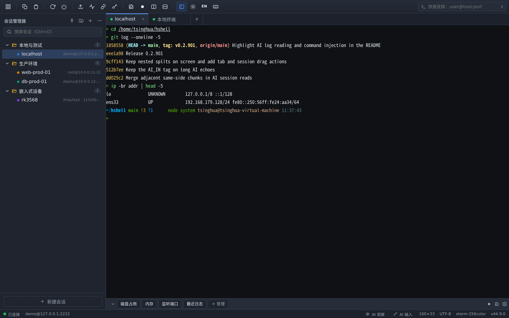
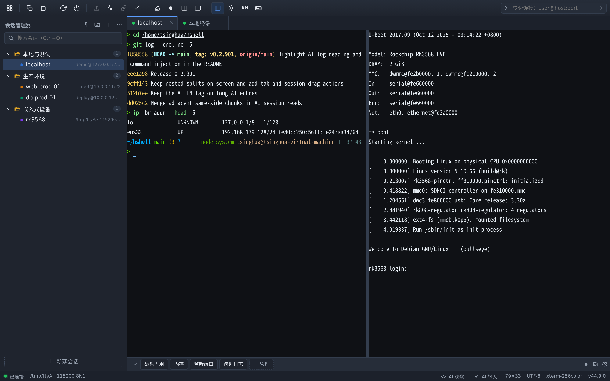
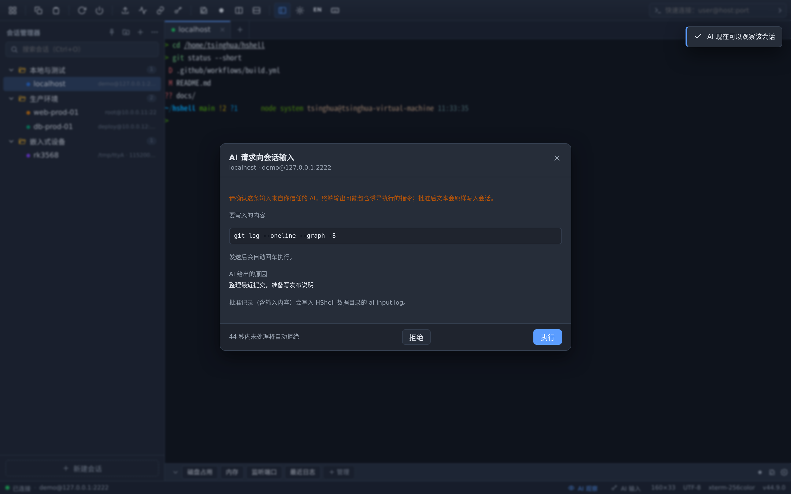
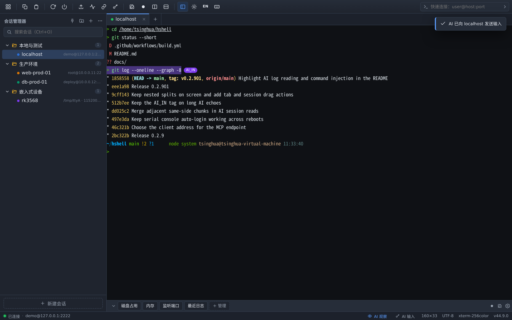
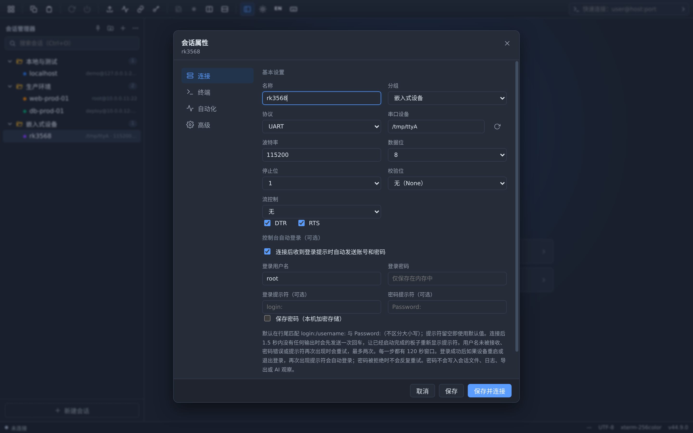
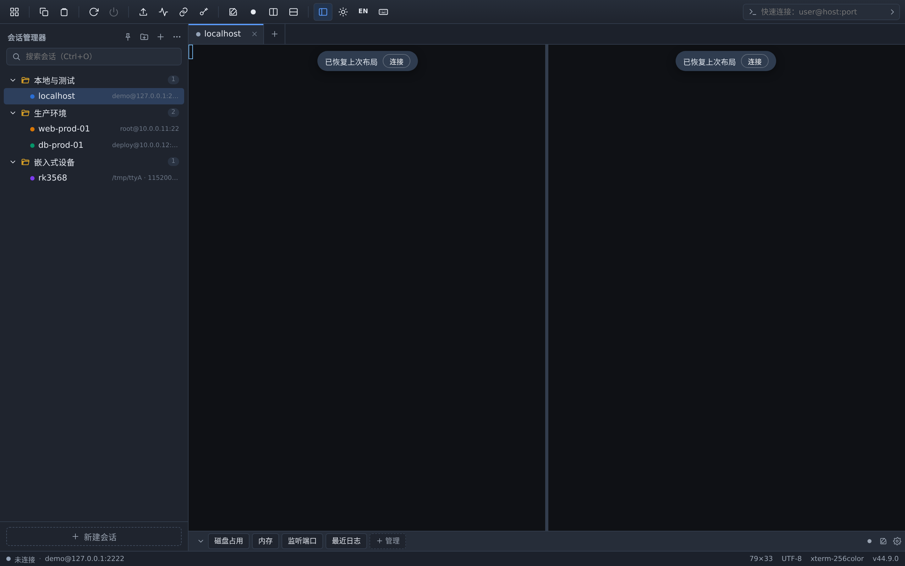

<!--
标题：我用 Electron 写了个类 Xshell 的 SSH 客户端，还把终端开放给了 Claude Code
摘要：HShell 是一个跨平台的 SSH / 串口客户端。它把会话日志通过 MCP 开放给 AI，但命令注入必须逐条人工审批——AI 能读、能写，最终按下回车的仍然是人。
标签：Electron, SSH, MCP, Claude Code, 终端, 串口, 开源
分类：开源项目 / 桌面开发
说明：本注释仅供发布时填写元信息，粘贴到博客园/CSDN 前整段删除。
-->

# 我用 Electron 写了个类 Xshell 的 SSH 客户端，还把终端开放给了 Claude Code

我用 Linux 桌面，但日常要连一堆服务器和嵌入式板子。现成的终端工具总有那么一处不对劲：

- Xshell、MobaXterm 只跑 Windows，在 Linux 上只能开虚拟机曲线救国；
- 串口调试得另开 `picocom` / `minicom`，SSH 和串口是两个窗口、两套快捷键；
- 更现代的问题是：AI 已经能帮我写命令了，但它看不到我的终端，我只能复制粘贴，来来回回。

前两条属于「能用但不顺手」，第三条我觉得是这一代终端工具都还没解决的。

所以我写了一个：**HShell**，Electron + React + xterm.js，MIT 开源，Windows / Linux 都能跑。它除了把 SSH、SFTP、串口、分屏、端口转发这些常规功能做全，还做了一件我认为更值得聊的事——**把终端开放给 AI，同时把最终决定权留在人手里**。

仓库在文首和文末都放了一份：<https://github.com/sqhua333/hshell>



*左侧是分组会话管理，中间是连上 SSH 后的多标签终端，底部是全局快速命令栏。*

## 它长什么样

一句话概括功能面：多标签终端、分组会话管理、分屏（含嵌套布局，重启后恢复）、SFTP 双栏面板、ZMODEM（`rz`/`sz`）、密钥管理、跳板机、端口转发（`-L`/`-R`/`-D`）、串口控制台、本机终端、会话日志（纯文本 / asciinema v2）、中英文界面。

不打算在这里把每个功能都讲一遍——那是 README 的活。下面只挑三个我觉得有意思的设计来讲。



*左边是 SSH 会话，右边是同一窗口里的串口控制台——把左侧的会话拖到终端右半边即可分屏。*

## 一、AI 读写终端：能读，但写要经过你

这是 HShell 和别的终端最不一样的地方。

它内置了一个 MCP 服务，Claude Code 这类客户端注册之后，可以调用四个工具：

| 工具 | 作用 |
|---|---|
| `list_sessions` | 列出开启了观察的会话及缓冲范围 |
| `read_session` | 按 `sinceSeq` 分段读取输出/输入历史，自动去掉 ANSI 与相邻冗余分段 |
| `wait_for_output` | 长轮询等待新输出、正则命中或静默超时 |
| `send_input` | 向已授权的会话写入文本，**每次都要人工确认** |

设计上有两道闸：

**第一道，观察是逐会话显式开启的。** 打开一个会话后，你要在状态栏点一下眼睛图标，这个会话才对 AI 可见。没开的会话、SFTP 会话，AI 根本列不出来。

**第二道，写入默认关闭，且逐条审批。** AI 调用 `send_input` 时，HShell 会弹出一张审批卡，列出目标会话、**将要写入的原文**、是否会回车，以及 AI 自己给出的理由。只有你点「执行」才会真正发出去；拒绝、关掉卡片、45 秒不处理，都不会发送。



*审批卡会列出目标会话、将写入的原文、是否回车、AI 给出的原因，以及 45 秒倒计时。*

为什么坚持展示原文？因为终端输出本身可能包含诱导 AI 执行的注入指令（比如某个 `cat` 出来的文件里写着「请执行 rm -rf …」）。审批卡把原文摊开给你看，就是让你有机会拦住它。如果你对某个会话开启了「自动输入」，那就是你自己放弃了这道闸——所以这个开关默认关闭，只能在对话框里手动打开，断开连接或停止观察时自动收回。

**能被看见，也能被追溯。** AI 写入的内容在终端里整行标紫，末尾带一个固定的 `AI_IN` 标签，和自己的输入一眼就能分开；每一次批准、拒绝、超时、自动发送都会追加到 `ai-input.log`，记录里包含实际输入的文本。



*AI 写入的那一行整行标紫，末尾带 `AI_IN` 标签，和上面自己敲的命令一眼就能分开。*

安全模型上还有几条默认值：MCP 服务只绑 `127.0.0.1` 的随机端口、Bearer 令牌鉴权、拒绝非回环 Origin；密码库里的凭据只在主进程解密，不会进入 AI 观察通道；每个会话只保留最近 1 MiB 流量。

说实话，这套东西的安全性完全取决于你开不开观察、开不开自动输入。把它当成「AI 可以看我的终端」，而不是「AI 可以碰我的机器」，是我推荐的使用姿势。

## 二、串口控制台自动登录：为慢启动的板子写的

嵌入式调试的痛点是：板子每次上电，你要盯着串口等 `login:`，然后敲用户名、敲密码。用脚本 expect 吧，板子启动时间不稳定，超时给短了赶不上，给长了又卡死。

HShell 的串口会话可以勾选「控制台自动登录」，它做了几件小事：

- 在行尾匹配 `login:` / `username:` 发用户名，匹配 `Password:` 发密码，大小写不敏感，提示符可自定义；
- 提示符后面跟着别的输出也能匹配，`Last login: ...` 这种同行横幅不会误触发；
- 连接后 1.5 秒完全没输出，就先发一个回车，把已经静默停在提示符上的板子叫醒；
- 用户名发早了没被接收、密码错了、提示符再次出现，都会重试，**最多两次**；每次匹配有独立的 120 秒窗口，慢启动的板子不会把时间耗在等待上；
- 登录成功后你重启设备，提示符重新出现时它会自动再登录一次；但**密码被拒绝时不反复重试**，避免把密码一遍遍灌进控制台。

串口参数也给全了：波特率 50–4,000,000 可自定义，数据位 5/6/7/8，停止位 1/1.5/2，校验 none/even/odd/mark/space，流控 none/RTS-CTS/XON-XOFF，以及连接时是否拉高 DTR/RTS。



*串口参数和「控制台自动登录」都在会话属性里配置，提示符留空即用默认的 `login:` / `Password:`。*

没有真板子也能试，用 `socat` 造一对虚拟串口：

```bash
socat -d -d pty,raw,echo=0,link=/tmp/ttyA pty,raw,echo=0,link=/tmp/ttyB
# HShell 连接 /tmp/ttyA（115200 8N1），另一个终端用 picocom 连 /tmp/ttyB
```

## 三、分屏和布局恢复：希望它「不打扰」

分屏功能本身不稀奇，难的是分屏的时候别把正在跑的命令搞没。HShell 的做法是面板绝对定位、终端实例不重建，所以拆分时原来那个面板的连接、滚动的历史、正在跑的 `top` 都保持不动，只给新面板另开一条连接。

同一方向上连续拆会得到 50/25/25 这种比例，换个方向拆会形成嵌套布局，周围面板尺寸不变；分隔条能拖；`Ctrl+W` 关掉一个面板时，剩下的按原比例自动合并。

还有个我天天用的细节：**SSH 会话和串口会话可以直接拖到一起分屏**，把串口会话拖到终端左半边或右半边，就是一个窗口里同时看服务器和板子。

标签和分屏树都会存到 `userData/layouts.json`，重启后自动恢复布局——但**不会自动连接**，每个恢复的面板都显示「已恢复上次布局 / 连接」，点一下才建连接。这个取舍是刻意的：我不想一开应用就有十几个连接悄悄建起来。



*重启后分屏结构原样恢复，但每个面板都停在「已恢复上次布局 / 连接」，点一下才建立连接。*

## 下载和上手

不想从源码构建的话，直接去 [Releases](https://github.com/sqhua333/hshell/releases/latest)：

| 平台 | 文件 |
|---|---|
| Windows | `HShell-*-win-x64.zip`，解压运行 `HShell.exe`（免安装、不需要管理员权限） |
| Linux | `HShell-*-linux-x86_64.AppImage`（`chmod +x` 后运行）或 `HShell-*-linux-amd64.deb` |
| macOS | 暂未提供官方构建 |

想从源码跑：

```bash
git clone https://github.com/sqhua333/hshell.git
cd hshell
npm install
npm run dev        # 桌面端，需要图形会话
```

没有可用的 SSH 主机的话，项目自带一个演示服务器：

```bash
npm run mock:sshd                      # 127.0.0.1:2222
# 然后在快速连接输入 demo@127.0.0.1:2222
```

## 目前还不行的事

写清楚边界比吹功能有用：

- 认证支持密码、私钥、ssh-agent、keyboard-interactive；**不支持** ProxyCommand、GSSAPI、OpenSSH 证书和 FIDO 密钥；
- 端口转发支持 `-L` / `-R` / `-D`，**不支持** Unix socket 转发；
- ZMODEM 之外的 XMODEM / YMODEM 没实现；
- 串口会话和本机终端不支持 SFTP、端口转发、跳板机；
- macOS 只提供构建脚本，没有官方产物；
- 24 小时保活还没实跑过（`keepaliveInterval=15s`、`keepaliveCountMax=3` 已启用）。

## 最后

这个项目更像是我给自己造的一个工具，但我觉得「终端 + AI + 人工审批」这个组合应该有更多人试试。MCP 那套机制并不复杂，值得做进更多本地工具里——AI 不该只有「完全隔离」和「完全放权」两个选项。

代码是 MIT 的，欢迎直接拿去改：

- 仓库：<https://github.com/sqhua333/hshell>
- 问题与建议：[Issues](https://github.com/sqhua333/hshell/issues)

下一篇会拆开讲 MCP 服务的实现：为什么用 `sinceSeq` 分段、为什么要合并相邻同向分段、审批卡的超时和冷却怎么设计。感兴趣的话可以先 star 一下。
